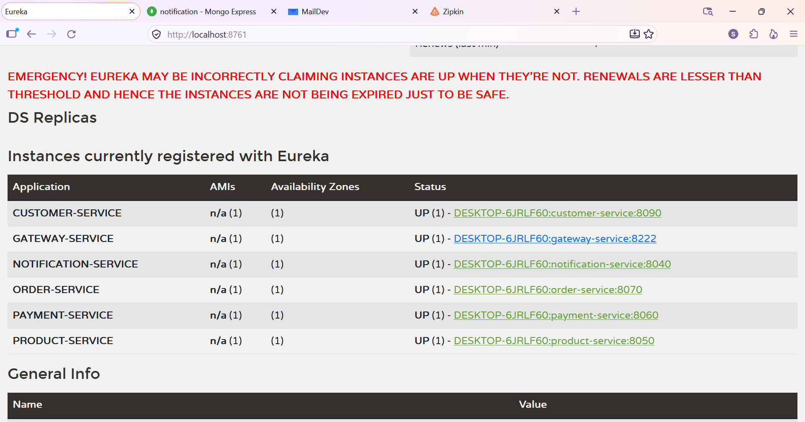
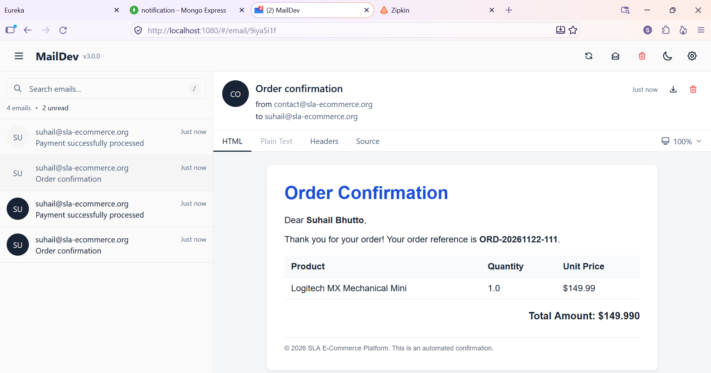
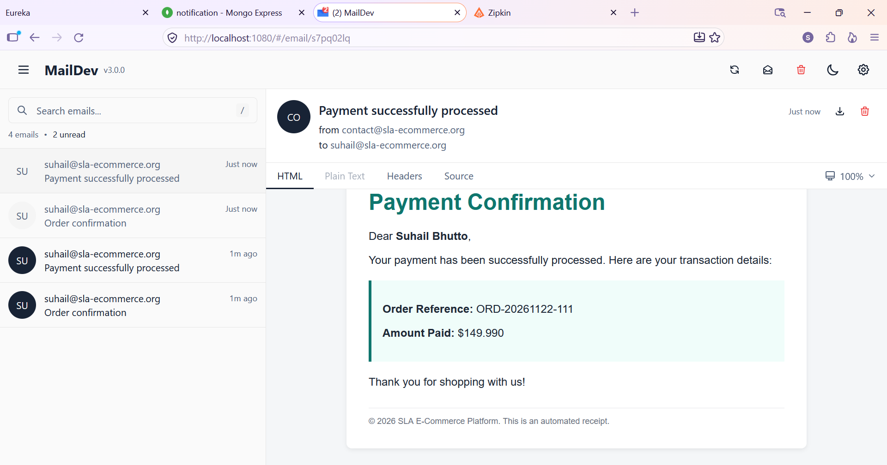
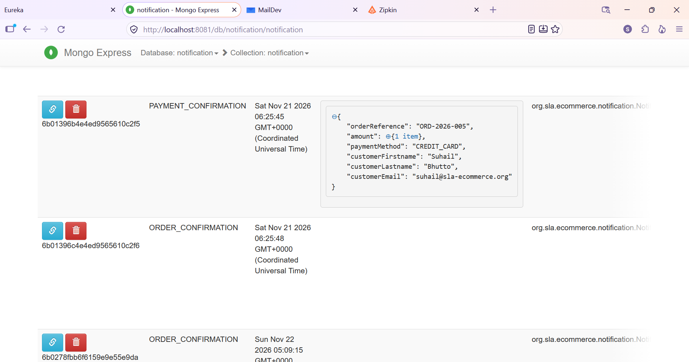

# E-commerce Microservices (Spring Cloud)

Event-driven Spring Boot and Spring Cloud microservices for placing orders, processing
payments and sending notifications, secured with Keycloak (OAuth 2.0 / OpenID Connect) and
run locally with Docker Compose.

## Architecture

```
Client → API Gateway (:8222) → Order Service (:8070) ──Kafka (:9092)──► Notification Service (:8040)
                                   │                                         ▲   ├─► MailDev (:1080 UI / :1025 SMTP)
                                   ├─► Customer Service (:8090)              │   └─► MongoDB (:27017, db: notification)
                                   ├─► Product Service (:8050)               │
                                   └─► Payment Service (:8060) ──Kafka───────┘

   Eureka Discovery (:8761) · Config Server (:8888) · Keycloak (:9098) · Zipkin (:9411)
```


## Tech stack
- **Runtime:** Java 17, Spring Boot 4.1.2, Spring Cloud (Config, Eureka, Gateway MVC, OpenFeign, LoadBalancer)
- **Security:** Keycloak 24.0.1, Spring Security OAuth2 resource server (JWT)
- **Messaging:** Apache Kafka 7.5 (Confluent) with Zookeeper
- **Databases:** PostgreSQL 16 and MongoDB 7.0; Flyway migrations in the product service
- **Observability and email:** Micrometer Tracing (Brave) + Zipkin, MailDev with HTML email templates
- **Tooling:** Docker Compose, pgAdmin, Mongo Express, GitHub Actions (build)

## Services (Spring Boot, run locally)

| Service | Port | Responsibility |
|---|---|---|
| config-server | 8888 | Serves externalized YAML configuration to the microservices |
| discovery | 8761 | Eureka service registry and instance health tracking |
| gateway | 8222 | Entry point: routing, JWT validation and role rules |
| customer | 8090 | Customer data and addresses |
| product | 8050 | Product catalog, categories and stock (Flyway migrations) |
| payment | 8060 | Payment processing; publishes payment events to `payment-topic` |
| order | 8070 | Creates orders (`POST /api/v1/orders`), calls customer, product and payment, publishes order events to `order-topic` |
| notification | 8040 | Consumes `order-topic` and `payment-topic`, stores notifications in MongoDB, sends emails via MailDev |

## Infrastructure (Docker Compose)

| Container | Image | Host port | Purpose |
|---|---|---|---|
| keycloak-ms | keycloak:24.0.1 | 9098 (→ 8080) | Identity provider; realm imported from `keycloak/ecommerce-realm.json` |
| ms_kafka | cp-kafka:7.5.0 | 9092 | Event streaming |
| zookeeper | cp-zookeeper:7.5.0 | 22181 (→ 2181) | Kafka coordination |
| ms_pg_sql | postgres:16-alpine | 5432 | Relational database |
| ms_pgadmin | pgadmin4 | 5050 (→ 80) | PostgreSQL admin UI |
| ms_mongo_db | mongo:7.0 | 27017 | Notification store |
| ms_mongo_express | mongo-express | 8081 | MongoDB admin UI |
| ms_mail_dev | maildev | 1080 (UI), 1025 (SMTP) | Local email testing |
| zipkin | openzipkin/zipkin | 9411 | Distributed tracing UI |

## Getting started

**Prerequisites:** JDK 17, Maven, Docker and Docker Compose

```bash
git clone https://github.com/suhailali123/ecommerce-microservices-spring-cloud.git
cd ecommerce-microservices-spring-cloud
docker compose up -d
docker compose ps        # all containers should be Up
```

Keycloak takes about 45 seconds to start and import the realm. Then start the Spring services,
each from its folder under `services/` with `./mvnw spring-boot:run`, in this order:
config-server → discovery → gateway → customer, product, payment, order → notification.

| UI | URL |
|---|---|
| Eureka dashboard | http://localhost:8761 |
| Keycloak admin | http://localhost:9098 |
| MailDev inbox | http://localhost:1080 |
| Zipkin | http://localhost:9411 |
| Mongo Express | http://localhost:8081 |
| pgAdmin | http://localhost:5050 |

All credentials in this project are for local development only. Change them for any shared environment.

## Security

The `ecommerce` realm is imported on startup from `keycloak/ecommerce-realm.json`. Keycloak runs in
dev mode with an in-memory database, so changes made in its admin console are lost when the
container is recreated; edit the realm file instead.

| User | Password | Roles |
|---|---|---|
| testuser | Test@12345 | user |
| adminuser | Admin@12345 | user, admin |

- **Gateway:** validates the JWT against `http://localhost:9098/realms/ecommerce` and maps realm roles
  to `ROLE_USER` / `ROLE_ADMIN`. `POST /api/v1/products/**` requires `ADMIN`; everything else under
  `/api/v1/**` requires `USER` or `ADMIN`.
- **Customer, product, payment and order services:** each validates the JWT itself as an OAuth2
  resource server, so calling them directly without a token returns `401`.
- **Service-to-service calls:** the order service calls customer, product and payment directly on
  their own ports and forwards the caller's bearer token (a Feign interceptor and a `RestTemplate`
  interceptor).

Verified behaviour:

| Request | Result |
|---|---|
| Gateway, no token | 401 |
| Gateway, `testuser` token, `GET /api/v1/products` | 200 |
| Gateway, `testuser` token, `POST /api/v1/products` | 403 |
| Gateway, tampered token | 401 |
| Product, order or customer service called directly without a token | 401 |
| Place an order with a `testuser` token | 200 |

## Try it

1. Get a token (the password grant is used here for local testing only):
   ```bash
   TOKEN=$(curl -s -X POST "http://localhost:9098/realms/ecommerce/protocol/openid-connect/token" \
     -d "grant_type=password" -d "client_id=ecommerce-client" \
     -d "username=testuser" -d "password=Test@12345" | jq -r .access_token)
   ```
2. List products and pick an ID (for example 152):
   ```bash
   curl -H "Authorization: Bearer $TOKEN" http://localhost:8222/api/v1/products
   ```
3. Create a customer through `/api/v1/customers`, or reuse an existing customer ID, then place an order:
   ```bash
   curl -X POST "http://localhost:8222/api/v1/orders" \
     -H "Authorization: Bearer $TOKEN" \
     -H "Content-Type: application/json" \
     -d '{
       "reference": "ORD-20261128-001",
       "amount": 149.99,
       "paymentMethod": "CREDIT_CARD",
       "customerId": "YOUR_CUSTOMER_ID",
       "products": [{ "productId": 152, "quantity": 1 }]
     }'
   ```
4. Verify the result:
   - the notification service logs show `order-topic` and `payment-topic` consumption
   - Mongo Express (`notification` database) shows the saved notification records
   - MailDev shows the Order Confirmation and Payment Confirmation emails
5. Open Zipkin, select a service and click **Run Query** to inspect traces.

## Screenshots

**Eureka: all services registered**



**Order confirmation email (MailDev)**



**Payment confirmation email (MailDev)**



**Notifications stored in MongoDB**



## What I changed and fixed
- **Stack:** built on Java 17 and Spring Boot 4.1.2 with Spring Cloud Config and Eureka.
- **MongoDB authentication (error 13, `credential=null`):** bound the credentials through Config Server with `authSource=admin`, so inserts are authenticated.
- **MailDev SMTP timeouts:** raised connection, read and write timeouts so concurrent order and payment emails no longer fail.
- **Zipkin span export:** added `spring-boot-starter-zipkin` and configured sampling and the endpoint (`http://localhost:9411/api/v2/spans`) so spans appear in Zipkin.
- **Build fix found by CI:** removed two BOM artifacts that were declared as dependencies and failed to resolve in a clean build.
- **Security:** added Keycloak with a realm import, JWT validation and role rules at the gateway, JWT validation in four services, and token relay for service-to-service calls.

These changes were made before the first commit, apart from the build fix and the security work.

## Known limitations
- Role rules are enforced at the gateway only; the downstream services accept any valid token.
- The token relay works for synchronous calls made while handling a request. Work triggered by Kafka events carries no user token, and the notification service does not validate tokens (it exposes no business API).
- Keycloak runs in dev mode, and the test users and passwords are for local use.
- Trace context is not yet propagated across every HTTP client and Kafka producer/consumer.
- Tests are limited to context-load checks so far.

## Roadmap
- Service-account tokens (client credentials) for calls that are not made on behalf of a user
- Role rules in the downstream services
- Transactional outbox pattern for reliable event publishing
- Unit and integration tests (JUnit 5, Mockito, Testcontainers)
- React front end for order placement

## Credits
Architecture based on a public Spring Cloud tutorial series, then upgraded, debugged and extended by me.